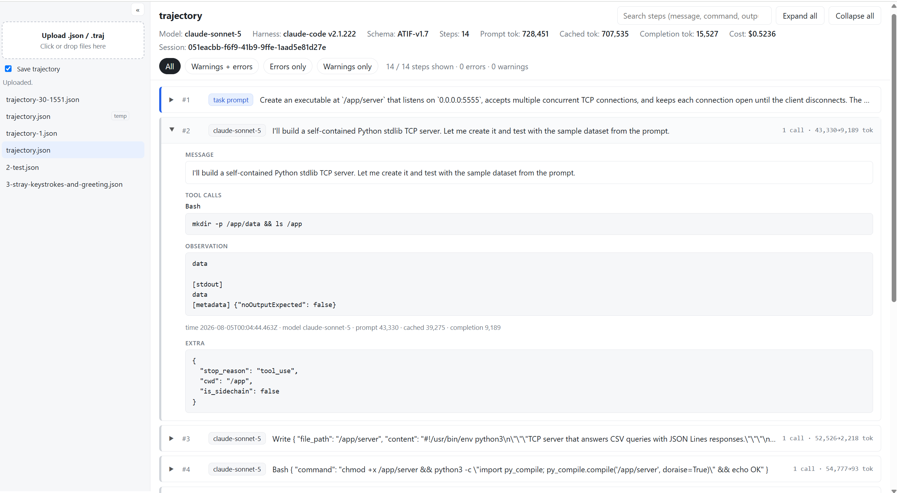

# Trajectory Viewer

<a href="screenshot1.png"></a>

A minimal viewer for agent trajectories. Supported formats (detected automatically):

| Format | Detected by | Notes |
|---|---|---|
| **ATIF** (Harbor / terminus-2 `trajectory.json`) | `steps[]` | parse errors / warnings from terminus feedback; "task complete" from `mark_task_complete` |
| **SWE-agent** `.traj` | `trajectory[]` or `attempts[]` | thought / action / observation per step; model and instance from `replay_config`; retry-loop files show the chosen (or last) attempt |
| **mini-swe-agent** (v1 text mode, v2 tool calls) | `messages[]` + `trajectory_format: "mini-swe-agent-*"` | format errors and command exceptions/timeouts flagged; exit status on the last step |
| **Anthropic Messages** | `messages[]` with `tool_use` / `tool_result` / `thinking` blocks | top-level `system`; per-message `usage` |
| **Chat logs** (OpenAI format) | `messages[]` (+ optional `llm_calls[]`) | each assistant message is a step, paired in order with `llm_calls` for tokens / cost; tool results become its observation |

- Upload `.json` / `.traj` files from the collapsible sidebar (click or drag-and-drop). They're stored on the server in `trajectories/`;
  uncheck **Save trajectory** to keep an upload only in a temp directory that is deleted when the server stops
  (marked *temp* in the list).
- Click a trajectory to view it: header with model / harness / token totals, plus one collapsible row per step.
- Filter by **All / Warnings + errors / Errors only / Warnings only**, search across messages, commands and outputs, and **Expand all / Collapse all**.

## Run

```bash
npm install
npm run build   # compiles src/server.ts -> dist/, src/client/app.ts -> public/app.js
npm start       # http://localhost:3000
```

Environment variables: `PORT` (default `3000`), `TRAJECTORY_VIEWER_HOST` (default `127.0.0.1`; the API has no
auth, so only expose it on other interfaces deliberately, e.g. `0.0.0.0`), `TRAJECTORIES_DIR` (default
`./trajectories`). Uploads are capped at 100 MB.

## Tests

```bash
npm test   # build + typecheck + node:test; needs Node >= 22.18, which runs the .ts tests directly (checked up front)
```

- `tests/formats.test.ts` — one fixture per supported format in `tests/fixtures/`, checking step mapping, tool
  calls / observations, metrics and error / warning / completion flags.
- `tests/fuzz.test.ts` — seeded fuzz (20k random inputs) plus known-awkward shapes: `normalize()` must never throw.
- `tests/server.test.ts` — starts the server on a random port with a temp directory: upload / list / read / delete,
  duplicate and concurrent same-name uploads, 413 for oversized bodies, path traversal, loopback binding, and a
  clear exit message when it can't listen.

CI (`.github/workflows/ci.yml`) runs `npm test` on Node 22.18 (the minimum) and 24 for every pull request and
push to `main`.

## Layout

- `src/server.ts` — Node `http` server (no framework): static files + JSON API
  - `GET /api/trajectories` — list
  - `POST /api/trajectories?name=<file>.json` — upload (raw JSON body; name collisions get a `-N` suffix)
  - `GET|DELETE /api/trajectories/<file>.json`
- `src/client/app.ts` — client-side TypeScript, compiled to plain browser JS
- `src/client/formats.ts` — converts supported formats into the viewer's ATIF-shaped model (`src/client/types.ts`)
- `public/` — `index.html`, `styles.css`

Step markers: red = error (parse / format / tool error), amber = warning (incl. non-submitted exit statuses
such as `LimitsExceeded`), green = task complete / submitted / final answer.
